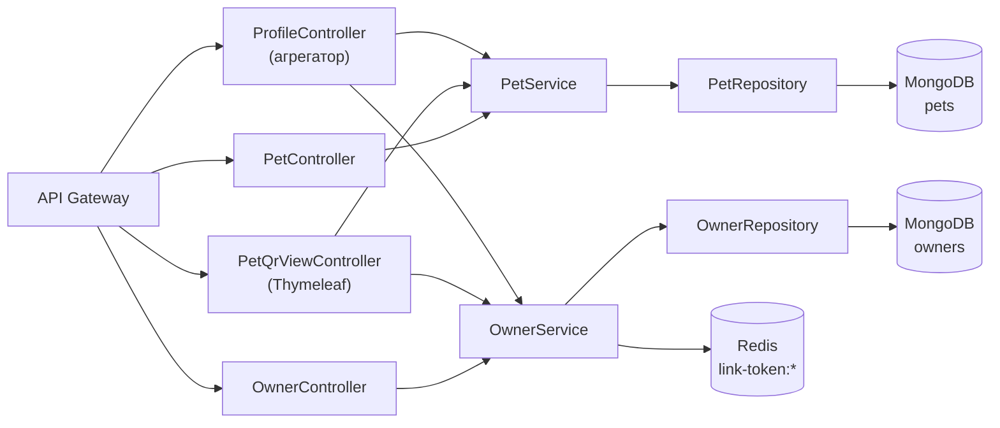
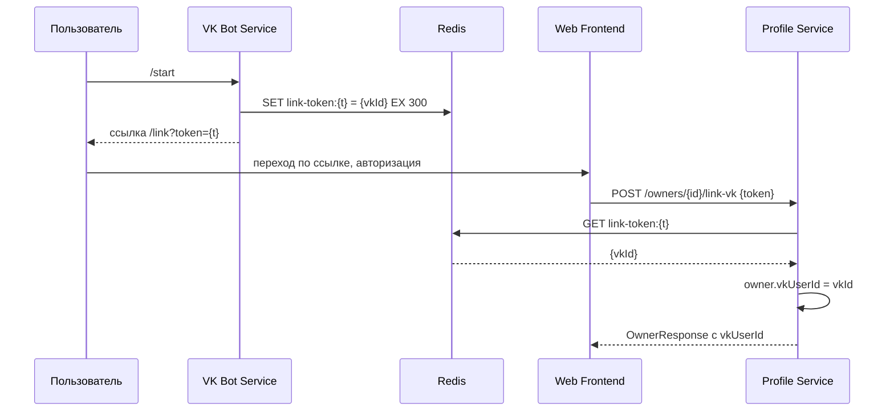

# 👤 Profile Service


> Централизованный реестр владельцев и питомцев: CRUD, поиск, привязка VK-аккаунта, генерация QR-кодов и публичная страница экстренной медицинской карты.

---

## 📋 Назначение

**Profile Service** — сервис, хранящий всю информацию о владельцах животных и их питомцах. Он играет роль «картотеки» платформы: к нему обращаются другие сервисы (Appointment, VK Bot, Pet Wearable, Health Analyzer) для получения данных о пользователях и животных.

Ключевые функции:

- **Управление владельцами** — CRUD, поиск, привязка VK-аккаунта через временный токен.
- **Управление питомцами** — CRUD, медицинская карта, параметры умного ошейника.
- **Генерация QR-кодов** — уникальный идентификатор для каждого питомца, встраиваемый в ошейник.
- **Публичная страница** экстренной медицинской карты по QR-коду, доступная без авторизации.
- **Агрегирующие эндпоинты** для межсервисного взаимодействия (получение VK ID владельца по питомцу и наоборот).

---

## ✨ Ключевые возможности

### Хранение в MongoDB

Данные хранятся в документо-ориентированной СУБД MongoDB. Такая модель идеально подходит для питомца: медицинская карта и параметры ошейника представлены вложенными объектами внутри одного документа, что позволяет читать всю информацию о животном **одним запросом** без соединений.

### Уникальные индексы

Для полей `vkUserId` (владельцы) и `qrCode` (питомцы) установлены уникальные индексы на уровне коллекции. Это гарантирует отсутствие дубликатов даже при конкурентных запросах.

### Привязка VK-аккаунта

Механизм безопасной связи между внутренним профилем и аккаунтом ВКонтакте:

1. Пользователь пишет боту `/start`.
2. VK Bot Service генерирует уникальный токен и сохраняет его в Redis с TTL 5 минут: `link-token:{token} → {vkUserId}`.
3. Пользователь переходит по ссылке на личный кабинет и авторизуется.
4. Фронтенд вызывает `POST /profile/owners/{id}/link-vk` с этим токеном.
5. Profile Service извлекает VK ID из Redis, привязывает к владельцу.
6. Токен **не удаляется** — Redis сам уберёт его по TTL (одноразовость обеспечивается в VK Bot Service при `/start`).

### QR-коды

Каждому питомцу при регистрации присваивается уникальный QR-код (`UUID.randomUUID()`). QR-код содержит ссылку на публичную страницу:

```
{gateway.url}/profile/pets/qr-scan/{qrCode}
```

Картинка генерируется **на лету** библиотекой ZXing в формате PNG, размеры задаются параметрами `width` и `height`.

### Публичная экстренная карта

Владелец может распечатать QR-код и повесить его на ошейник. Если питомец потеряется, любой прохожий может отсканировать код и попасть на страницу с:
- основной информацией о питомце (имя, вид, порода, возраст, чип);
- контактами владельца (имя, телефон, email);
- списками аллергий и хронических заболеваний.

Страница рендерится через **Thymeleaf** (`pet-info.html`) и **не требует авторизации** — это сознательное архитектурное решение, чтобы любой человек мог оперативно помочь животному.

---

## 🛠 Технологический стек

| Компонент | Технология |
|---|---|
| Язык | Java 21 |
| Фреймворк | Spring Boot 3 |
| Web | Spring Web MVC, Spring Web (REST) |
| Шаблонизатор | Thymeleaf |
| Хранилище | MongoDB (Spring Data MongoDB) |
| Кэш / токены | Redis (Spring Data Redis) |
| Безопасность | Spring Security OAuth2 Resource Server, Keycloak |
| QR | ZXing (Zebra Crossing) |
| Валидация | Jakarta Bean Validation |
| Логирование | SLF4J + Logback |
| Контейнеризация | Docker (multi-stage build) |

---

## 🏗 Архитектура сервиса



---

## 📁 Структура проекта

```
profile-service/
├── src/main/java/ru/sibsutis/profile/
│   ├── ProfileApplication.java
│   ├── api/
│   │   ├── controller/
│   │   │   ├── OwnerController.java        # REST: владельцы
│   │   │   ├── PetController.java          # REST: питомцы + QR
│   │   │   ├── PetQrViewController.java    # MVC: публичная страница
│   │   │   └── ProfileController.java      # Агрегирующие эндпоинты
│   │   ├── dto/
│   │   │   ├── OwnerRequest.java
│   │   │   ├── OwnerResponse.java
│   │   │   ├── PetRequest.java
│   │   │   └── PetResponse.java
│   │   └── exception/
│   │       ├── ResourceNotFoundException.java
│   │       ├── DuplicateResourceException.java
│   │       └── GlobalExceptionHandler.java
│   └── core/
│       ├── model/
│       │   ├── Owner.java
│       │   └── Pet.java
│       ├── repository/
│       │   ├── OwnerRepository.java
│       │   └── PetRepository.java
│       └── service/
│           ├── OwnerService.java
│           └── PetService.java
├── src/main/resources/
│   ├── templates/
│   │   └── pet-info.html                   # Thymeleaf-шаблон
│   └── application.properties
├── Dockerfile
├── build.gradle
└── README.md
```

---

## 📡 API

Все внешние запросы приходят через **API Gateway** с JWT в заголовке `Authorization: Bearer <token>`.

### Владельцы — `/profile/owners`

| Метод | Путь | Описание | Авторизация |
|---|---|---|---|
| `POST` | `/profile/owners` | Создать владельца | ✅ |
| `GET` | `/profile/owners` | Все владельцы | ✅ |
| `GET` | `/profile/owners/{id}` | Владелец по ID | ✅ |
| `GET` | `/profile/owners/search?query=` | Поиск по email/телефону/имени/фамилии | ✅ |
| `PUT` | `/profile/owners/{id}` | Обновить владельца | ✅ |
| `DELETE` | `/profile/owners/{id}` | Удалить владельца | ✅ |
| `POST` | `/profile/owners/{id}/link-vk` | Привязать VK по токену | ✅ |
| `GET` | `/profile/owners/by-vk-id/{vkUserId}` | Получить владельца по VK ID | ✅ |

### Питомцы — `/profile/pets`

| Метод | Путь | Описание | Авторизация |
|---|---|---|---|
| `POST` | `/profile/pets` | Зарегистрировать питомца | ✅ |
| `PUT` | `/profile/pets/{id}` | Обновить данные питомца | ✅ |
| `GET` | `/profile/pets` | Все питомцы | ✅ |
| `GET` | `/profile/pets/{petId}` | Питомец по ID | ✅ |
| `GET` | `/profile/pets/owner/{ownerId}` | Питомцы владельца | ✅ |
| `GET` | `/profile/pets/qr/{qrCode}` | Питомец по QR-коду (JSON) | ✅ |
| `GET` | `/profile/pets/{id}/qrcode?width=&height=` | PNG QR-кода | ✅ |
| `DELETE` | `/profile/pets/{petId}` | Удалить питомца | ✅ |
| `GET` | `/profile/pets/qr-scan/{qrCode}` | HTML-страница экстренной карты | 🌐 **Публичный** |

### Агрегирующие эндпоинты — `/profile`

| Метод | Путь | Описание |
|---|---|---|
| `GET` | `/profile/owners/vk-user-id?petId=` | VK ID владельца по ID питомца |
| `GET` | `/profile/pets/vk-user-id/{vkUserId}` | Питомцы владельца по VK ID |

Эти эндпоинты упрощают жизнь другим сервисам: вместо двух вызовов (получить питомца → получить владельца) достаточно одного.

### Примеры запросов

**Создать владельца:**

```http
POST /profile/owners
Authorization: Bearer <JWT>
Content-Type: application/json

{
  "id": "6dc0348a-0de9-4e4e-9fba-56472c76cc1e",
  "email": "owner@example.com",
  "firstName": "Пётр",
  "lastName": "Петров",
  "phone": "+79991234567"
}
```

**Создать питомца:**

```http
POST /profile/pets
Authorization: Bearer <JWT>
Content-Type: application/json

{
  "ownerId": "6dc0348a-0de9-4e4e-9fba-56472c76cc1e",
  "name": "Тимоша",
  "species": "dog",
  "age": 10,
  "breed": "poodle",
  "chipNumber": "1231231",
  "medicalRecord": {
    "vaccinations": [
      { "name": "Rabies", "date": "2025-08-01", "nextDueDate": "2026-08-01" }
    ],
    "allergies": ["Chicken"],
    "chronicDiseases": []
  },
  "collar": {
    "active": true,
    "homeInfo": {
      "alerting": true,
      "radius": 10,
      "lat": 82.95087,
      "lon": 55.01304
    }
  }
}
```

**Привязать VK:**

```http
POST /profile/owners/6dc0348a-.../link-vk
Authorization: Bearer <JWT>
Content-Type: application/json

{ "token": "b1c2d3e4-..." }
```

**Получить PNG QR-кода:**

```http
GET /profile/pets/81e9f1d3-.../qrcode?width=400&height=400
```

### Обработка ошибок

| Исключение | HTTP-статус | Когда возникает |
|---|---|---|
| `ResourceNotFoundException` | 404 | Владелец/питомец/токен не найдены |
| `DuplicateResourceException` | 409 | Дубликат `id`, `vkUserId` или `qrCode` |
| `Exception` | 500 | Общая ошибка |

---

## 🗄 Модель данных

### Документ `owners`

| Поле | Тип | Индекс | Описание |
|---|---|---|---|
| `id` | String | PK | UUID, задаётся клиентом |
| `vkUserId` | Long | **unique** | ID пользователя ВКонтакте (nullable) |
| `email` | String | — | Email владельца |
| `firstName` | String | — | Имя |
| `lastName` | String | — | Фамилия |
| `phone` | String | — | Телефон |

### Документ `pets`

| Поле | Тип | Индекс | Описание |
|---|---|---|---|
| `id` | String | PK | UUID |
| `ownerId` | String | — | Ссылка на владельца |
| `name` | String | — | Кличка |
| `species` | String | — | Вид (dog, cat, ...) |
| `age` | Integer | — | Возраст |
| `breed` | String | — | Порода |
| `chipNumber` | String | — | Номер чипа |
| `medicalRecord` | Object | — | Медкарта (см. ниже) |
| `collar` | Object | — | Параметры ошейника (см. ниже) |
| `qrCode` | String | **unique** | UUID QR-кода |

**Вложенный `medicalRecord`:**

- `vaccinations[]` — массив прививок (`name`, `date`, `nextDueDate`);
- `allergies[]` — список аллергий;
- `chronicDiseases[]` — список хронических заболеваний.

**Вложенный `collar`:**

- `active` — активен ли ошейник;
- `homeInfo` — параметры домашней зоны (`alerting`, `radius`, `lat`, `lon`).

### Redis

| Ключ | TTL | Назначение |
|---|---|---|
| `link-token:{token}` | 5 мин | Временная связка токен → VK ID для привязки аккаунта |

---

## 🔄 Ключевые сценарии

### Привязка VK-аккаунта



### Поиск владельцев

Метод `findOwnersByQuery` загружает всех владельцев и фильтрует их в потоке по частичному совпадению (регистронезависимо) в полях `email`, `phone`, `firstName`, `lastName`. Запросы короче 2 символов возвращают пустой список — они неинформативны.

### Сканирование QR-кода

1. Прохожий сканирует QR-код на ошейнике.
2. Открывается публичный URL через API Gateway: `/profile/pets/qr-scan/{code}`.
3. `PetQrViewController` получает питомца по QR-коду и его владельца, складывает в модель.
4. Thymeleaf-шаблон `pet-info.html` рендерит адаптивную страницу с контактами и медицинской информацией.
5. Никакой авторизации — любой может помочь питомцу.

---

## 🎨 UI: публичная страница `pet-info.html`

Thymeleaf-шаблон **`pet-info.html`** — аккуратная адаптивная карточка в стиле «mobile-first»:

- шапка с зелёным градиентом и кличкой питомца;
- блок основных данных (вид, порода, возраст, чип);
- карточка владельца с контактными данными;
- списки аллергий и хронических заболеваний;
- футер с обращением к тому, кто нашёл питомца.

Шаблон использует только чистый CSS (без внешних библиотек), корректно отображается на мобильных устройствах и мгновенно загружается (никаких JS-фреймворков).

---

## ⚙️ Конфигурация

### Переменные окружения

| Переменная | Назначение | Значение по умолчанию |
|---|---|---|
| `MONGO_HOST` | Адрес MongoDB | `localhost` |
| `MONGO_PORT` | Порт MongoDB | `27017` |
| `REDIS_HOST` | Адрес Redis | `localhost` |
| `REDIS_PORT` | Порт Redis | `6379` |
| `KEYCLOAK_ISSUER_URI` | Issuer URI Keycloak | `http://localhost:8080/realms/clinic-realm` |
| `GATEWAY_URL` | Публичный адрес API Gateway (для QR-ссылок) | `http://localhost:8888` |

### `application.properties` (фрагмент)

```properties
server.port=8083
spring.application.name=profile

spring.data.mongodb.uri=mongodb://${MONGO_HOST:localhost}:${MONGO_PORT:27017}/vet-clinic
spring.data.redis.host=${REDIS_HOST:localhost}
spring.data.redis.port=${REDIS_PORT:6379}

spring.thymeleaf.cache=false
gateway.url=${GATEWAY_URL:http://localhost:8888}

spring.security.oauth2.resourceserver.jwt.issuer-uri=${KEYCLOAK_ISSUER_URI}
```

---

## 🚀 Запуск

### Локально (Docker Compose)

```bash
docker compose up -d profile-service mongo redis keycloak
```

### Запуск только сервиса

```bash
cd services/profile
./gradlew bootRun
```

### Сборка образа

```bash
docker build -t profile-service:latest .
```

### Проверка

```bash
# Health
curl http://localhost:8083/actuator/health

# Публичная страница по QR
curl http://localhost:8888/profile/pets/qr-scan/{code}

# Авторизованный запрос
curl -H "Authorization: Bearer $TOKEN" \
     http://localhost:8888/api/profile/owners
```

---

## 🔗 Связанные сервисы

| Сервис | Как использует Profile Service |
|---|---|
| **Appointment Service** | Получает владельца и питомца для записи на приём |
| **VK Bot Service** | Получает данные владельца по VK ID и питомцев для отображения |
| **Pet Wearable Service** | Получает список питомцев с активными ошейниками для генерации телеметрии |
| **API Gateway** | Проксирует запросы и проверяет JWT |
| **Keycloak** | Выдаёт токены для валидации запросов |

---
